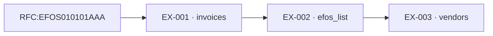
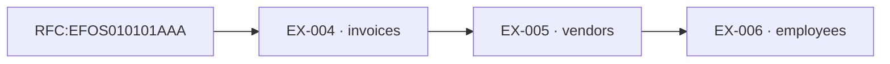
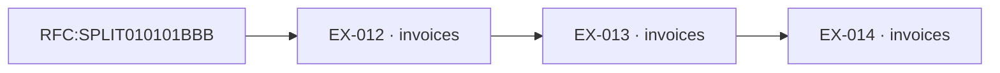

# Case File — Forensic Auditor

## 1. Header
Empresa auditada: COMPANY010101AAA. Periodo auditado: 2025-01-02 a 2026-01-31. Estate seed: 2026. LLM calls: 0; MXN cost: $0.00; wall-clock: 0.002s; deterministic: True.

## 2. Executive summary
El análisis determinista identificó 5 hallazgo(s) a partir de registros SQLite y cerró 1 lead(s) sin acusación.

| | |
|---|---|
| Findings | 5 (3 proven, 2 probable) |
| Total exposure | $678,160.00 MXN |
| Leads investigated and closed | 1 |

## 3. RFC:EFOS010101AAA — phantom_vendor
**Rule broken:** CFF Art. 69-B: operaciones con EFOS.
**Amount and confidence:** $116,000.00 MXN — proven

**What happened:** Los registros revisados vinculan RFC:EFOS010101AAA con el patrón phantom_vendor. La evidencia citada sustenta una exposición de $116,000.00 MXN. El hallazgo se reporta conforme a CFF Art. 69-B: operaciones con EFOS. y queda limitado a los documentos y transferencias incluidos en este expediente.

**Money trail:**

**Exhibits:**

| ID | Source | Record | What it proves |
|---|---|---|---|
| EX-001 | invoices | EFOS-001 | Factura emitida por EFOS010101AAA por $116,000.00. |
| EX-002 | efos_list | EFOS010101AAA | RFC EFOS010101AAA aparece en la lista EFOS con estatus definitivo . |
| EX-003 | vendors | EFOS010101AAA | Registro maestro del proveedor EFOS010101AAA revisado contra la lista EFOS. |

**Reconciliation:** peso_amount = $116,000.00; EX-001 ($116,000.00) = $116,000.00. Exhibits monetarios: EX-001.

**Adversarial review / deterministic validation:** Objeción: coincidir con una lista no bastaría si la factura perteneciera a otro RFC o el estatus no fuera aplicable. Sobrevivió porque el emisor, la factura, el maestro de proveedor y el registro EFOS definitivo/presunto enlazan al mismo RFC. El hard validator además confirmó existencia, unicidad, entidades, importes y conciliación en 3 exhibits (1 monetario(s)).

## 3. RFC:EFOS010101AAA, EMP:0001 — kickback
**Rule broken:** Políticas internas de compras: conflicto de interés y pago a tercero relacionado.
**Amount and confidence:** $116,000.00 MXN — proven

**What happened:** Los registros revisados vinculan RFC:EFOS010101AAA, EMP:0001 con el patrón kickback. La evidencia citada sustenta una exposición de $116,000.00 MXN. El hallazgo se reporta conforme a Políticas internas de compras: conflicto de interés y pago a tercero relacionado. y queda limitado a los documentos y transferencias incluidos en este expediente.

**Money trail:**

**Exhibits:**

| ID | Source | Record | What it proves |
|---|---|---|---|
| EX-004 | invoices | EFOS-001 | Factura del proveedor EFOS010101AAA vinculada al flujo bajo revisión. |
| EX-005 | vendors | EFOS010101AAA | Proveedor EFOS010101AAA comparte CLABE con un empleado. |
| EX-006 | employees | EMP:0001 | Empleado EMP:0001 comparte la CLABE registrada con el proveedor. |

**Reconciliation:** peso_amount = $116,000.00; EX-004 ($116,000.00) = $116,000.00. Exhibits monetarios: EX-004.

**Adversarial review / deterministic validation:** Objeción: usar el mismo banco no implica conflicto. Sobrevivió porque no se comparó la institución, sino la CLABE completa, no vacía y exactamente igual entre el proveedor y el empleado exhibidos. El hard validator además confirmó existencia, unicidad, entidades, importes y conciliación en 3 exhibits (1 monetario(s)).

## 3. RFC:VENDORA0101, RFC:VENDORB0101 — round_tripping
**Rule broken:** Políticas internas de tesorería: flujo circular concentrado en 14 días y con importes equivalentes, sin justificación comercial.
**Amount and confidence:** $300,000.00 MXN — probable

**What happened:** Los registros revisados vinculan RFC:VENDORA0101, RFC:VENDORB0101 con el patrón round_tripping. La evidencia citada sustenta una exposición de $300,000.00 MXN. El hallazgo se reporta conforme a Políticas internas de tesorería: flujo circular concentrado en 14 días y con importes equivalentes, sin justificación comercial. y queda limitado a los documentos y transferencias incluidos en este expediente.

**Money trail:**

**Exhibits:**

| ID | Source | Record | What it proves |
|---|---|---|---|
| EX-007 | bank_txns | CYCLE-001 | Transferencia COMPANY-CLABE a VENDOR-A. |
| EX-008 | bank_txns | CYCLE-002 | Transferencia VENDOR-A a VENDOR-B. |
| EX-009 | bank_txns | CYCLE-003 | Transferencia VENDOR-B a COMPANY-CLABE. |
| EX-010 | vendors | VENDORA0101 | El registro maestro vincula RFC VENDORA0101 con la CLABE VENDOR-A citada en el ciclo. |
| EX-011 | vendors | VENDORB0101 | El registro maestro vincula RFC VENDORB0101 con la CLABE VENDOR-B citada en el ciclo. |

**Reconciliation:** peso_amount = $300,000.00; EX-007 ($100,000.00) + EX-008 ($100,000.00) + EX-009 ($100,000.00) = $300,000.00. Exhibits monetarios: EX-007, EX-008, EX-009.

**Adversarial review / deterministic validation:** Objeción: tres transferencias parecidas podrían ser operaciones independientes. Sobrevivió como probable —no proven— porque los pasos conectan y cierran el ciclo, están ordenados, ocurren dentro de 14 días y sus importes varían como máximo 2%. El hard validator además confirmó existencia, unicidad, entidades, importes y conciliación en 5 exhibits (3 monetario(s)).

## 3. RFC:SPLIT010101BBB — threshold_splitting
**Rule broken:** Políticas internas de compras: prohibición de fraccionar adquisiciones para evadir el umbral de autorización.
**Amount and confidence:** $146,160.00 MXN — probable

**What happened:** Los registros revisados vinculan RFC:SPLIT010101BBB con el patrón threshold_splitting. La evidencia citada sustenta una exposición de $146,160.00 MXN. El hallazgo se reporta conforme a Políticas internas de compras: prohibición de fraccionar adquisiciones para evadir el umbral de autorización. y queda limitado a los documentos y transferencias incluidos en este expediente.

**Money trail:**

**Exhibits:**

| ID | Source | Record | What it proves |
|---|---|---|---|
| EX-012 | invoices | SPLIT-001 | Factura por $48,720.00, inmediatamente debajo del umbral de $50,000 y dentro de una ventana de 14 días. |
| EX-013 | invoices | SPLIT-002 | Factura por $48,720.00, inmediatamente debajo del umbral de $50,000 y dentro de una ventana de 14 días. |
| EX-014 | invoices | SPLIT-003 | Factura por $48,720.00, inmediatamente debajo del umbral de $50,000 y dentro de una ventana de 14 días. |

**Reconciliation:** peso_amount = $146,160.00; EX-012 ($48,720.00) + EX-013 ($48,720.00) + EX-014 ($48,720.00) = $146,160.00. Exhibits monetarios: EX-012, EX-013, EX-014.

**Adversarial review / deterministic validation:** Objeción: una factura bajo el umbral puede ser ordinaria. Sobrevivió como probable porque el mismo emisor acumuló al menos tres facturas de $45,000 a menos de $50,000 dentro de 14 días. El hard validator además confirmó existencia, unicidad, entidades, importes y conciliación en 3 exhibits (3 monetario(s)).

## 3. RFC:COMPANY010101AAA — revenue_inflation
**Rule broken:** NIF C-3 y políticas de cierre contable: ingresos cancelados no deben mantenerse reconocidos.
**Amount and confidence:** $116,000.00 MXN — proven

**What happened:** Los registros revisados vinculan RFC:COMPANY010101AAA con el patrón revenue_inflation. La evidencia citada sustenta una exposición de $116,000.00 MXN. El hallazgo se reporta conforme a NIF C-3 y políticas de cierre contable: ingresos cancelados no deben mantenerse reconocidos. y queda limitado a los documentos y transferencias incluidos en este expediente.

**Money trail:**

**Exhibits:**

| ID | Source | Record | What it proves |
|---|---|---|---|
| EX-015 | invoices | REV-001 | Factura cancelada que fue registrada como ingreso. |
| EX-016 | ledger | 1 | Crédito de ingreso asociado a la factura REV-001 que permanece sin reversa completa. |
| EX-017 | ledger | 2 | Asiento de contrapartida asociado a la factura REV-001 sin reversa de ingresos. |

**Reconciliation:** peso_amount = $116,000.00; EX-015 ($116,000.00) = $116,000.00. Exhibits monetarios: EX-015.

**Adversarial review / deterministic validation:** Objeción: una factura cancelada pudo haberse revertido correctamente. Sobrevivió porque el hard validator volvió a calcular los asientos de ingreso y confirmó que permanece un saldo neto positivo no revertido. El hard validator además confirmó existencia, unicidad, entidades, importes y conciliación en 3 exhibits (1 monetario(s)).

## 4. Leads not pursued
- **RFC:DECOY010101AAA** — Signal: threshold_splitting. Closed because: Se revisaron 2 factura(s) de $45,000 a menos de $50,000; no hay tres operaciones dentro de una ventana de 14 días. Tools: SQL invoices by issuer, amount and issue_date. Closed by: investigator.

## 5. Method and limits
Los detectores consultan SQLite en modo read-only y publican un candidato solo después de un hard validator determinista. No se usa LLM: la narrativa se forma únicamente con evidencia ya validada. Total exposure deduplica registros monetarios compartidos entre hallazgos; peso_amount conserva la exposición propia conciliable de cada caso. La auditoría no consulta fuentes externas, no atribuye identidades fuera del estate y no prueba intención. Los patrones marcados probable requieren investigación humana. Reproduce mediante POST /audit/run con el mismo estate y seed; el wall-clock es una medición operativa y puede variar entre ejecuciones.
